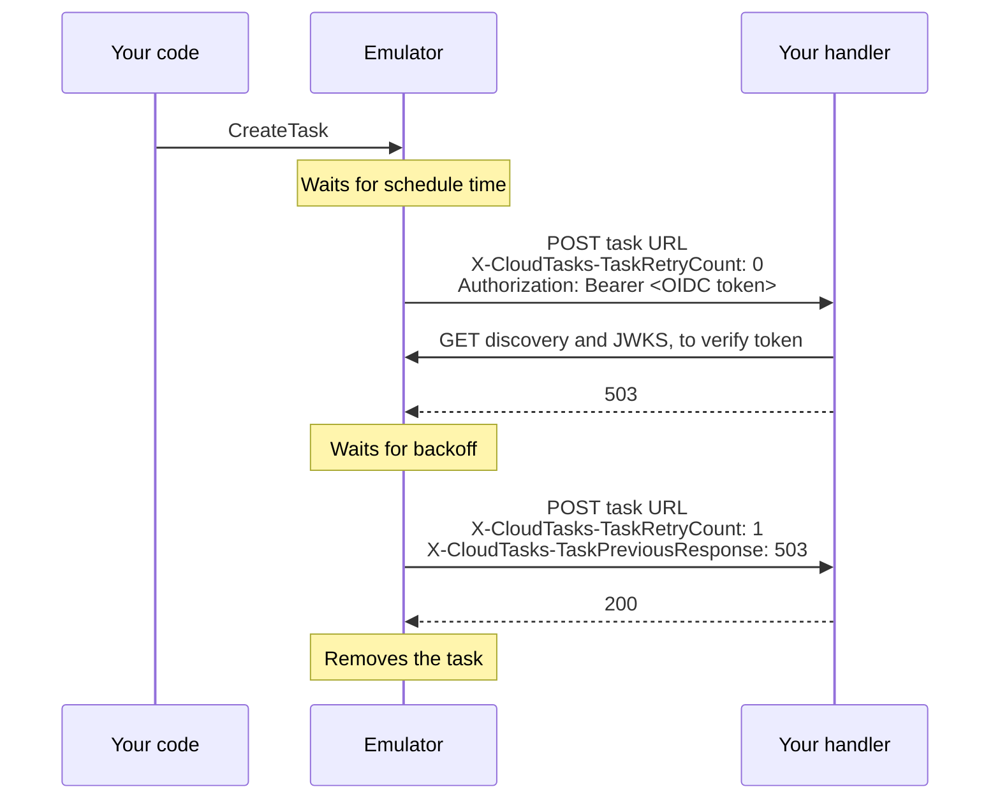

<h1 align="center">cloud-tasks-emulator</h1>

<p align="center">Google Cloud Tasks on your machine, tested against recordings of the real service.</p>

<p align="center">
  <a href="https://github.com/mwpryer/cloud-tasks-emulator/stargazers"></a>
</p>

`cloud-tasks-emulator` is a local emulator of the Google Cloud Tasks v2 API. Code using the official client libraries or `gcloud` runs against it with no GCP project.

- **Every v2 RPC.** Queues, tasks, batches, IAM policies and CMEK config, served over gRPC and REST on one port.
- **Real dispatch.** Tasks reach your handlers with the headers, retries and rate limits that Cloud Tasks applies.
- **Verifiable tokens.** The emulator signs OIDC tokens with a key made each run, and handlers verify them through its discovery document.
- **Same answers as Cloud Tasks.** We test the emulator against transcripts recorded from real Cloud Tasks, so its responses and error messages match the real service.
- **Built for tests.** Queues can exist from startup, one endpoint waits until a queue is empty, and another resets the emulator.

## Why

Google ships no Cloud Tasks emulator, and real Cloud Tasks cannot reach a handler on `localhost`. Testing against it needs a project and a public tunnel. A stubbed client avoids both, but then retries, headers, deadlines and token checks first run in production.

The emulator runs that whole path on your machine. Your code calls it as it would call Cloud Tasks, and your handlers receive what Cloud Tasks would send.

## How it works

One port serves gRPC, REST and OIDC discovery. REST requests become gRPC calls inside the process, so both get the same checks.

```text
             your code: client libraries, gcloud or curl
                 │                                 │
            REST │                                 │ gRPC
                 │                                 │
┌────────────────┼──── emulator on LISTEN_ADDR ────┼────────────────┐
│                ▼                                 ▼                │
│   ┌─────────────────────────┐       ┌─────────────────────────┐   │
│   │ REST                    │       │ gRPC API                │   │
│   │ turns JSON into         ├──────►│ checks each request     │   │
│   │ gRPC calls              │       │ as Cloud Tasks does     │   │
│   └─────────────────────────┘       └────────────┬────────────┘   │
│                                                  │                │
│                                                  ▼                │
│   ┌─────────────────────────┐       ┌─────────────────────────┐   │
│   │ scheduler               │◄─────►│ in-memory state         │   │
│   │ rate limits, retries    │       │ queues, tasks, policies │   │
│   └────────────┬────────────┘       └─────────────────────────┘   │
│                │                                                  │
│                │                    ┌─────────────────────────┐   │
│                │                    │ OIDC discovery and keys │◄──┼───┐
│                │                    └─────────────────────────┘   │   │
│                │                                                  │   │
└────────────────┼──────────────────────────────────────────────────┘   │
                 │  pushes each attempt with Cloud Tasks                │
                 │  headers and an OIDC or OAuth token                  │
                 │                                                      │
                 ▼                                                      │
           your handlers ───────────── verify OIDC tokens ──────────────┘
```

## Install

```sh
cargo install cloud-tasks-emulator
```

Building needs no `protoc`. The emulator runs on Linux and macOS. On Windows, use [Docker](#docker) or WSL.

Each [release](https://github.com/mwpryer/cloud-tasks-emulator/releases) also carries a Linux x86_64 binary.

## Quick start

```sh
LISTEN_ADDR=127.0.0.1:8123 OIDC_ISSUER=http://127.0.0.1:8123 QUEUES= cloud-tasks-emulator
```

| Variable | Meaning |
| --- | --- |
| `LISTEN_ADDR` | Address that serves gRPC, REST and OIDC discovery, for example `127.0.0.1:8123` |
| `OIDC_ISSUER` | Origin your handlers reach the emulator at. OIDC tokens name it as their issuer |
| `QUEUES` | Full queue names separated by commas, created at startup with the default config. Empty for none |

## Docker

```sh
docker run -p 127.0.0.1:8123:8123 -e OIDC_ISSUER=http://127.0.0.1:8123 -e QUEUES= ghcr.io/mwpryer/cloud-tasks-emulator
```

The image sets `LISTEN_ADDR` to `0.0.0.0:8123`. Inside the container, `localhost` is the container itself, so tasks reach handlers on your machine at `host.docker.internal`. On Linux, that needs `--add-host=host.docker.internal:host-gateway`.

With Compose, handlers in other containers reach the emulator by its service name:

```yaml
services:
  tasks:
    image: ghcr.io/mwpryer/cloud-tasks-emulator
    ports: ["127.0.0.1:8123:8123"]
    environment:
      OIDC_ISSUER: http://tasks:8123
      QUEUES: projects/p/locations/l/queues/q
```

## Connect

Point a client at `LISTEN_ADDR` without TLS. The emulator accepts any credentials, project ID and location ID.

```sh
# gcloud
export CLOUDSDK_API_ENDPOINT_OVERRIDES_CLOUDTASKS=http://127.0.0.1:8123/

# REST
curl http://127.0.0.1:8123/v2/projects/p/locations/l/queues
```

In Python, pass an insecure gRPC channel:

```python
import grpc
from google.cloud import tasks_v2
from google.cloud.tasks_v2.services.cloud_tasks.transports import CloudTasksGrpcTransport

channel = grpc.insecure_channel("127.0.0.1:8123")
client = tasks_v2.CloudTasksClient(transport=CloudTasksGrpcTransport(channel=channel))
```

## Handlers

- HTTP tasks go to their URL with the `X-CloudTasks-*` headers.
- The emulator signs OIDC tokens with a key made each run. Handlers verify them through `<OIDC_ISSUER>/.well-known/openid-configuration`.
- OAuth tokens are opaque, as only Google APIs could check a real one.
- Unlike Cloud Tasks, the emulator sends tokens to http URLs, so local handlers receive them.

Here is one HTTP task with an OIDC token whose first attempt fails.



## Test helpers

- `QUEUES` creates queues at startup, so tests don't need to.
- `GET /emulator/<queue name>:waitIdle` blocks until the queue holds no tasks, then returns 204. It returns 404 for an unknown queue and 409 for a paused queue with tasks left.
- `POST /emulator:reset` puts the emulator back in its startup state, then returns 204. It drops every queue, task and CMEK config, frees the names of deleted queues and tasks, and creates the `QUEUES` queues again. It keeps the OIDC key, so handlers keep verifying tokens.

```sh
curl http://127.0.0.1:8123/emulator/projects/p/locations/l/queues/q:waitIdle
curl -X POST http://127.0.0.1:8123/emulator:reset
```

## Differences from Cloud Tasks

- State lives in memory, so a restart loses every queue and task.
- The emulator does not check that a project, location or service account exists. It stores IAM policies without enforcing them.
- It stores CMEK keys without encrypting anything.
- It does not support App Engine targets. It answers as Cloud Tasks does for a project without an App Engine app.
- It serves v2 only, without the Locations RPCs.
- The `ListQueues` filter returns `UNIMPLEMENTED` for bare words and for text comparisons other than `:`.
- REST rejects the `fields` parameter, so it returns no partial responses.

## Develop

Check every change with `cargo test`, `cargo clippy --all-targets` and `cargo fmt --check`.

```text
                the same cases in tests/conformance.rs
          ┌────────────────────────┴────────────────────────┐
   record │                                                 │ cargo test
          │                                                 │
          ▼                                                 ▼
┌───────────────────┐                             ┌───────────────────┐
│ real Cloud Tasks  │                             │ emulator          │
└─────────┬─────────┘                             └─────────┬─────────┘
          │         each run records its responses          │
          │         and the requests it pushes              │
          │                                                 │
          ▼                                                 ▼
┌───────────────────┐                             ┌───────────────────┐
│ transcript        ├───── tests/recordings ─────►│ transcript        │
└───────────────────┘         must match          └───────────────────┘
```

`cargo test` compares the emulator with the transcripts in `tests/recordings`. To record them again, install `cloudflared` and run:

```sh
CLOUD_TASKS_PROJECT=<id> CLOUD_TASKS_LOCATION=<id> CLOUD_TASKS_SERVICE_ACCOUNT=<email> CLOUD_TASKS_TOKEN=$(gcloud auth print-access-token) cargo test --test conformance -- --ignored record
```

Record in a sandbox project, since a run creates and deletes queues there. The service account must be in that project, and you need permission to act as it.
